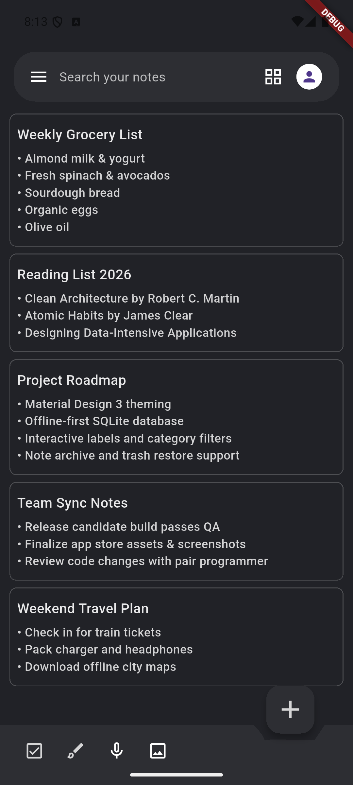
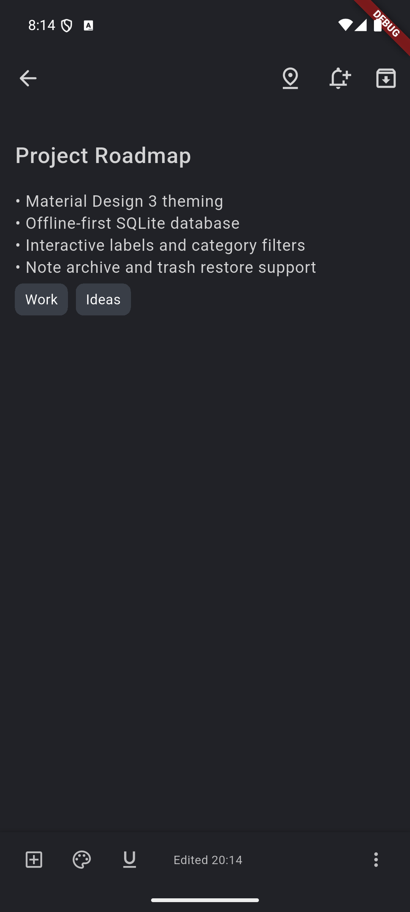

# 📝 Google Keep Clone — Flutter App

A **pixel-faithful lookalike of [Google Keep](https://keep.google.com/)** built with Flutter. This project replicates the core note-taking experience of Google Keep, including the masonry grid layout, colorful note cards, labels, archive, reminders, and more — all wrapped in a clean dark-themed UI.

> **Lookalike Notice:** This app is a clone/lookalike of **Google Keep**, Google's popular note-taking application. It is built purely for educational and portfolio purposes and is not affiliated with or endorsed by Google LLC.

---

## 📸 Screenshots

| Home — Notes Grid | Note Detail / Editor |
|:-----------------:|:--------------------:|
|  |  |

---

## ✨ Features

- 🗒️ **Create, edit & delete notes** — Full note editor with title and body
- 🏷️ **Labels** — Organize notes by custom labels; add/edit/delete labels
- 📌 **Pin notes** — Pin important notes to the top of the list
- 🔔 **Reminders** — Set reminders for individual notes
- 🗂️ **Archive & Trash** — Archive notes or move them to trash with restore support
- 🔍 **Search** — Search across notes and labels instantly
- 🖼️ **Image support** — Attach and crop images to notes (via `image_picker` & `image_cropper`)
- 🎨 **Note colors** — Assign accent colors to note cards just like Google Keep
- 📐 **Grid / List toggle** — Switch between masonry grid and list view
- 🌗 **Dark theme** — Material dark UI matching Google Keep's aesthetic
- 💾 **Local database** — Offline-first with SQLite (`sqflite`)
- 🔐 **Secure storage** — Sensitive data stored with `flutter_secure_storage`
- 🌍 **Localization** — Multi-language support via `flutter_localizations` & `intl`

---

## 🛠️ Tech Stack

| Category | Package / Tool |
|---|---|
| Framework | Flutter (Dart) |
| State Management | `provider` + `state_extended` |
| Local Database | `sqflite` |
| Secure Storage | `flutter_secure_storage` |
| Preferences | `shared_preferences` |
| Image Handling | `image_picker`, `image_cropper` |
| Permissions | `permission_handler` |
| Animations | `rive` |
| Grid Layout | `waterfall_flow` |
| Localization | `flutter_localizations`, `intl`, `intl_utils` |
| Network | `http` |
| Toast | `fluttertoast` |

---

## 🚀 Getting Started

### Prerequisites

- Flutter SDK `>=3.4.4 <4.0.0`
- Dart SDK
- Android Studio / Xcode (for device/simulator)

### Installation

```bash
# Clone the repository
git clone https://github.com/your-username/keeps_note_clone.git
cd keeps_note_clone

# Install dependencies
flutter pub get

# Run the app
flutter run
```

---

## 📁 Project Structure

```
lib/
├── components/       # Reusable UI widgets (cards, image widget, labels)
├── controllers/      # Business logic controllers (notes, labels)
├── data/
│   └── models/       # Data models (Note, Label, etc.)
├── generated/        # Auto-generated localization files
├── l10n/             # Localization ARB files
├── screens/          # App screens (home, detail, archive, trash, settings…)
├── utils/            # Helpers, colors, search delegate, side-menu utils
└── main.dart         # App entry point

assets/
├── database/         # Pre-seeded demo SQLite database
└── screenshots/      # README screenshots
```

---

## 📄 License

This project is open source and available under the [MIT License](LICENSE).

---

## 🙏 Acknowledgements

- Inspired by **[Google Keep](https://keep.google.com/)** — Google's note-taking app
- Built with ❤️ using [Flutter](https://flutter.dev/)
